# Grokking in ridge regression and two-layer networks: experiments and bound checks

## Summary

| Paper figure | Setup that matches it | Status vs. the paper's figure |
|---|---|---|
| Fig. 1 left (ridge/features, zero teacher) | **random ReLU features** + zero teacher, d=100 (50 runs) | matches: test loss within ≈0.02 from step 10 on; train loss lower than the paper's before step 10² (unresolved) |
| Fig. 1 right (two-layer ReLU net, both layers trained) | two-layer net, zero teacher (50 runs) | matches: test loss at 1/10/10²/10³/10⁴ steps = 0.49/0.45/0.32/0.22/0.13 vs ≈0.47/0.37/0.28/0.21/0.17; train loss starts lower (0.25 vs ≈0.46) |
| Fig. 2 (ridge sweeps, realizable) | Gaussian features N(0, I/m) | t2 and its bound match; measured t1 ≈15 % lower; the paper's dashed t1 line is ≈2.5× below the literal Eq. 8 (unresolved) |
| Fig. 3 (random features, 4 sweeps) | random ReLU features, **zero teacher** | matches (t2 = 1.5×10⁴ / 1.6×10⁵ / 1.6×10⁶ for λ = 10⁻⁴ / 10⁻⁵ / 10⁻⁶ vs ≈ 1.5×10⁴ / 10⁵ / 10⁶). The *single-ReLU teacher* written in the text does **not** match the curves (test floor ≈0.2, t2 never reached) |
| Fig. 4 (two-layer net sweeps) | two-layer net, zero teacher (6 seeds) | same trends; magnitudes within ≈1.1–2×; t1 falls with m in both |
| Fig. 5 (surrogate accuracy) | random ReLU features, zero teacher | matches (0.14/0.16/0.19/0.46 at 10²…10⁵ vs ≈0.15/0.18/0.19/0.45) |
| Fig. 6 (label noise) | random ReLU features, d=50, zero teacher + noise | matches (test at 10⁴ steps 0.109 vs ≈0.12); noise barely changes grokking time |
| Fig. 7 (random Fourier features) | RFF, θ\*=e₁ | right shape (plateau ≈0.9, late drop to ≈0) but my drop is ≈1 decade too early (t2 = 2.3×10⁴ vs ≈2×10⁵); cause not found |

Other results: the paper's Eq. 8 bounds held in all 2670 (run, bound) checks; t2 ∝ 1/(ηλ) holds essentially exactly; t1 is independent of λ.
A methodological finding: the paper's Figs. 1-left, 3, 5 and 6 behave like a **zero teacher on random-ReLU features**, not like the identity-feature model of Sec. 5.1 (which does match Fig. 2). Why the text describes a single-ReLU teacher for Fig. 3 is unresolved.

## Setup and how to run
```bash
pip install -r requirements.txt
python -m pytest tests -q                                   # 7 tests, incl. spectral-vs-explicit GD checks
python -m src.sweep --all                                   # ridge main figures, sweeps, bound checks, tables -> results/
python -m src.step1 --config configs/fig1_realizable.yaml   # one ridge experiment
python -m src.nonlinear --fig1l-rf --seeds 50               # Fig. 1 left (random features, zero teacher)
python -m src.nonlinear --full --seeds 50 --T-full 600000   # Fig. 1 right (two-layer net, ~40 min on 12 cores)
python -m src.nonlinear --fig3p --seeds 5                   # Fig. 3 (zero teacher, paper panel values)
python -m src.nonlinear --fig4 --seeds 6                    # Fig. 4 (two-layer net sweeps, ~1 h on 12 cores)
python -m src.appendix                                      # Figs. 5-7
```
Layout: `src/data.py` (teacher-student data), `src/train.py` (GD + exact spectral engine + critical times), `src/theory.py` (Eq. 6/7/8 + regime tags),
`src/step1.py`, `src/sweep.py`, `src/diagnose.py`, `src/report.py` (ridge experiments, sweeps, diagnosis, auto-generated tables), `src/nonlinear.py` (random-features and two-layer ReLU experiments),
`src/appendix.py` (Figs. 5–7), `configs/*.yaml`, `results/` (JSON/CSV/PNG/PDF), `tests/`.
Tables between `<!--...-->` markers are generated from `results/*.json` by `src/report.py`.

## Methods

### Model (paper Sec. 2, 5.1, Remark A.14)
Features φ(x_i) ~ N(0, I_m/m) i.i.d. (identity feature map), noiseless labels y = Φθ\*, ‖θ\*‖=1 (or θ\*=0), init θ(0) ~ N(0, ν²I_m),
loss L_n(θ;λ) = (1/2n)‖Φθ−y‖² + (λ/2)‖θ‖², full-batch GD with fixed η. Train metric L_n(θ) = (1/2n)‖Φθ−y‖² (with the ½); test metric L(θ) = E(⟨θ−θ\*,φ⟩)² = ‖θ−θ\*‖²/m (no ½, exact closed form; we also log a 10k-sample Monte-Carlo estimate and the ½-scaled test loss `test_half`).
Feature scaling: with unit-variance features λ_max(ΦᵀΦ)/n ≈ 17 at n=100, m=1000, so η=1 would diverge. With the paper's N(0,I/m) it is ≈0.017, so η=1 is far inside the stable region. η is never changed; every config is checked (`train.check_stable`) and unstable ones would be logged and skipped. Across all 1470 sweep runs none was GD-unstable (η < 2/(λ+λ_max/n) always held); 20 runs (λ=1, η=1 in F1/F3, all at the degenerate end of the λ sweep) violate the paper's stricter condition η < 1/(λ+λ_max/n) of Thm 4.4 while still converging, and are flagged in the logs.

### Definitions (paper Sec. 3)
* **t1(ε)** = last step with L_n(θ(t)) ≥ ε ("overfitting time"). **t2(c)** = first step with L(θ(t)) ≤ c ("generalisation time"). **Grokking time = t2 − t1.** ε = c = 0.01 unless stated.
* This is the paper's definition, not a "fraction of the plateau value" threshold. Measured on a dense log grid (≈4000 points) refined by integer bisection (`train.critical_times`), assuming no sign change between adjacent grid points.
* **Bounds** are the *literal* Eq. 8 (Gaussian features): `t1 ≤ n ln(14 m ν²/ε) / (2 η λ⁺min(ΦᵀΦ))`, `t2 ≥ ln((m−n)ν²/(8mε)) / (2.02 η λ)` with the realised λ⁺min of each sampled dataset. Both are one-sided bounds, not predictions.
* **Engine.** GD is linear, so θ(t) is evaluated exactly at any t from the SVD of Φ (`SpectralGD`); this reaches t≈10⁷ cheaply. It matches a literal explicit-GD loop to ≈4e-16 absolute error over 200k steps (`results/*.json → crosscheck`, and `tests/`).
  The explicit loop is the reference; the spectral engine produces all reported numbers.
* **Defaults not given by the paper** (project choices): 10 seeds for the ridge experiments (Fig. 1 left/right: 50 as in the paper), θ\* ~ N(0,I) normalised to 1, 10k test samples, ~200 log-spaced log points, step budget ≥ 10× the t2 bound (and ≥ 20/(ηλ)).

### Regime tags
Theorem 4.2's conditions have unspecified constants (Ω, O). Every sweep point is tagged with the **literal conditions at C=1, b²=3/2, δ=0.05** (`theory.regime_tags`):
Eq. 3 `n ≥ b⁴‖θ\*‖⁴ε⁻² log(1/δ)`; Eq. 4; Eq. 5; and the step-size condition `η < 1/(λ+b²)` of Thm 4.2. `in_regime_eq345` ignores the step-size condition; `in_regime` includes it.
Three sweep families (base point n=100, m=1000, λ=1e-4):

| family | teacher | ε=c | ν² | η | regime |
|---|---|---|---|---|---|
| F1_realizable_paper | ‖θ\*‖=1 | 0.01 | 1 | 1 | **out of regime** (Eq. 3 would need n ≈ 6.8×10⁴; also η=1 > 1/(λ+b²)). This is the paper's own Fig. 2 setting. |
| F2_realizable_inregime | ‖θ\*‖=1 | 0.5 | 100 | 0.5 | **in regime** (Eq. 3 needs n ≥ 27; Eq. 4, 5, η-condition hold) for most points; points violating a condition are tagged individually. Designed by me; ε=0.5 is far larger than the paper's 0.01. |
| F3_zero_teacher | θ\*=0 | 0.01 | 1 | 1 | Eq. 3–5 vacuously true; out of regime only through η=1 (> 1/(λ+b²)). |

Sweeps (each point 10 seeds, datasets paired across λ/ν²/η): λ ∈ 2⁻¹⁹…2⁰ (paper: 2⁻¹⁹…2⁻¹⁵; Eq. 8 needs ηλ ≤ 0.01, i.e. λ ≤ 2⁻⁷, beyond that only measured values exist), ν² ∈ 10⁻²…10⁶, n ∈ {10…900}, m ∈ {1000…10⁴}, η ∈ {0.25…8} (F2: {1/16…0.5}).
Slope-fit ranges were fixed before looking at results (see `slope_tests` docstring).


The non-linear experiments (Part II) use the network N(x) = Σ_j a_j relu(⟨w_j, x⟩) (no 1/√m factor, as in the paper), inputs x ~ N(0, I_d) (not specified by the paper).
Random features: only `a` is trained (a_j ~ N(0,1), w_j ~ N(0, ν²/(dm) I), fixed), so GD is linear and is evaluated exactly with the SVD of the feature matrix. Two-layer net: both layers trained with explicit full-batch GD + weight decay, a_j ~ N(0,1/m), w_j ~ N(0, ν²/d I).

## Part I — Ridge regression with Gaussian features (paper Sec. 4–5.1, Fig. 2)

### Main curves

Figures: `results/fig1_realizable.{png,pdf}` (realizable teacher, Fig. 2 defaults) and `results/fig1_left_zero_teacher.{png,pdf}` (zero teacher with these *identity* features at Fig. 1-left's settings; this run does **not** match the paper's Fig. 1 left, see Part II). Mean ± std over 10 seeds; vertical lines: Eq. 8 bounds (dashed) and measured t1/t2 (dash-dot).
All three stages appear: (i) the train loss falls to ε within ≈200 steps while test loss is still ≈1.0 (≈ its initial value ν²), (ii) a long stage where test loss decays only slowly (from ≈1.0 it is still ≈0.7 at t≈10³ in the realizable run), (iii) test loss collapses at t ≈ 10⁴–10⁵ (realizable) / 2×10⁵ (zero teacher).
Note that, on the paper-style linear axis, "plateau" means a slow decay rather than a flat line.

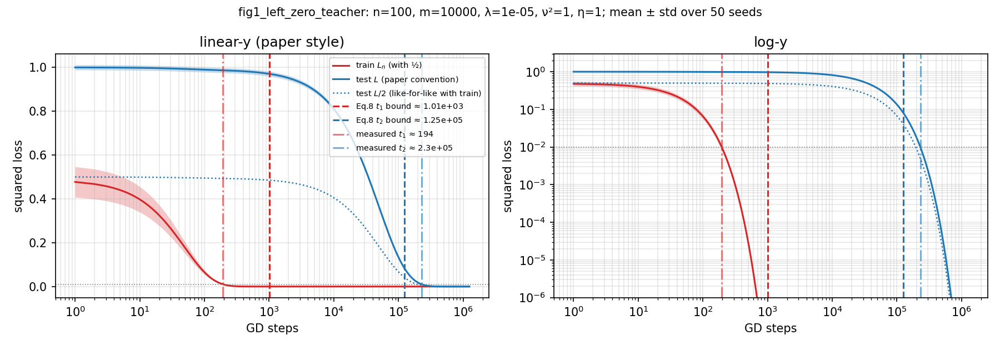
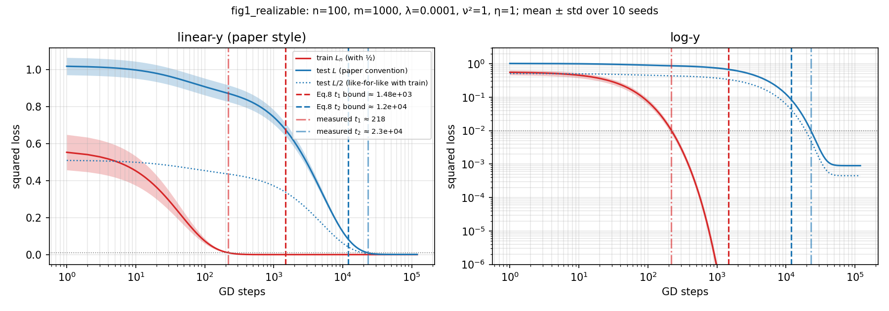

<!--STEP1-->
| config | measured t1 (mean±std) | Eq.8 t1 bound | bound/measured | measured t2 | Eq.8 t2 bound | bound/measured | gap t2−t1 measured | gap lower bound (t2_b−t1_b) | valid (t1≤b, t2≥b) |
|---|---|---|---|---|---|---|---|---|---|
| fig1_realizable | 218±13.1 | 1.48e+03 | 6.81 | 2.3e+04±221 | 1.2e+04 | 0.521 | 2.28e+04 | 1.05e+04 | True (10/10 seeds) |
| fig1_left_zero_teacher | 194±7.96 | 1.01e+03 | 5.2 | 2.3e+05±589 | 1.25e+05 | 0.542 | 2.3e+05 | 1.24e+05 | True (50/50 seeds) |
<!--/STEP1-->

### Bound validity (every run, in-regime vs out-of-regime reported separately)
Check (a): measured t1 ≤ Eq. 8 t1 bound and measured t2 ≥ Eq. 8 t2 bound, per seed and per sweep point. Points where the Eq. 8 t2 bound is vacuous (ν² too small, ln arg ≤ 1) or Eq. 8 does not apply (ηλ>0.01) have no bound and are not counted; t1=0 runs are excluded from ratios.

<!--VALIDITY-->
| family | tag | bound | measured runs | bound holds | median bound/measured | bound/measured range |
|---|---|---|---|---|---|---|
| F1_realizable_paper | in_regime=False | t1 | 480 | 480/480 | 6.69 | 2.01 – 1.25e+03 |
| F1_realizable_paper | in_regime=False | t2 | 420 | 420/420 | 0.52 | 0.0494 – 0.877 |
| F1_realizable_paper | in_regime_eq345=False | t1 | 480 | 480/480 | 6.69 | 2.01 – 1.25e+03 |
| F1_realizable_paper | in_regime_eq345=False | t2 | 420 | 420/420 | 0.52 | 0.0494 – 0.877 |
| F2_realizable_inregime | in_regime=True | t1 | 430 | 430/430 | 5.81 | 2.33 – 919 |
| F2_realizable_inregime | in_regime=False | t1 | 40 | 40/40 | 211 | 3.35 – 1.09e+03 |
| F2_realizable_inregime | in_regime=True | t2 | 380 | 380/380 | 0.592 | 0.051 – 0.851 |
| F2_realizable_inregime | in_regime=False | t2 | 20 | 20/20 | 0.599 | 0.585 – 0.608 |
| F2_realizable_inregime | in_regime_eq345=True | t1 | 440 | 440/440 | 5.81 | 2.33 – 919 |
| F2_realizable_inregime | in_regime_eq345=False | t1 | 30 | 30/30 | 4.29 | 3.35 – 1.09e+03 |
| F2_realizable_inregime | in_regime_eq345=True | t2 | 380 | 380/380 | 0.592 | 0.051 – 0.851 |
| F2_realizable_inregime | in_regime_eq345=False | t2 | 20 | 20/20 | 0.599 | 0.585 – 0.608 |
| F3_zero_teacher | in_regime=True | t1 | 20 | 20/20 | 7.06 | 6.54 – 7.55 |
| F3_zero_teacher | in_regime=False | t1 | 460 | 460/460 | 7.08 | 2.01 – 1.24e+03 |
| F3_zero_teacher | in_regime=True | t2 | 20 | 20/20 | 0.535 | 0.523 – 0.548 |
| F3_zero_teacher | in_regime=False | t2 | 400 | 400/400 | 0.535 | 0.0511 – 0.884 |
| F3_zero_teacher | in_regime_eq345=True | t1 | 480 | 480/480 | 7.07 | 2.01 – 1.24e+03 |
| F3_zero_teacher | in_regime_eq345=True | t2 | 420 | 420/420 | 0.535 | 0.0511 – 0.884 |

Overall: 2670/2670 (run, bound) checks satisfy the bound.
<!--/VALIDITY-->

**Reading.** No violation occurred anywhere (including out-of-regime points). The t2 bound is within a factor ≈1.7–2 of the truth near the default, and 5–20× loose for the largest λ (where the 2.02 constant and the ln-term matter). The t1 bound is loose by ≈5–7× at the defaults and by up to ≈10³× at large n (λ⁺min → 0 as n → m makes the bound blow up while the real t1 grows only ~linearly in n).
Because the bounds hold everywhere, the in-/out-of-regime split is *not* evidence for or against the regime conditions: all configurations pass, and the F2 in-regime family just confirms the bound where the theorem's assumptions are (nominally) met. Figures: `results/sweep_F*.{png,pdf}` (per family, 5 panels, measured vs Eq. 8) and `results/sweep_pred_vs_measured.{png,pdf}` (log-log scatter of all runs).

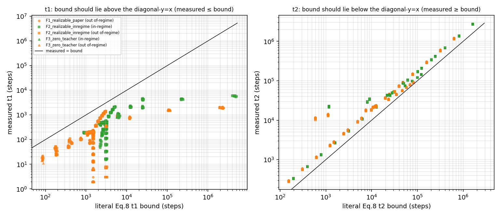
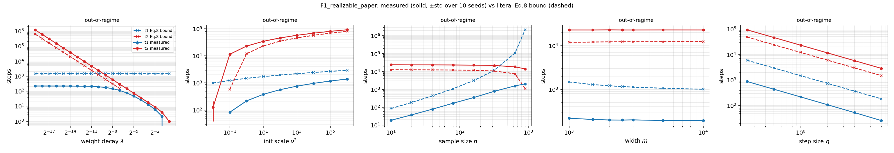
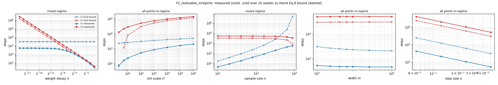
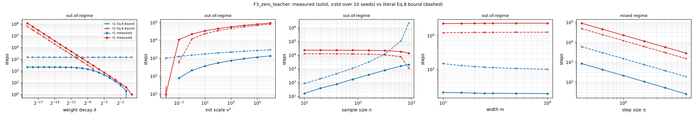

### Scaling (slope tests, 95% t-intervals over 10 seeds)
<!--SLOPES-->
| family | quantity | fitted (mean over seeds) | 95% CI (t, 10 seeds) | theory expects |
|---|---|---|---|---|
| F1_realizable_paper | log-log slope, t2 vs 1/(ηλ), λ-sweep (ηλ≤1e-3) | 1.0000 | [1.0000, 1.0000] | 1 |
| F1_realizable_paper | log-log slope, t2 vs 1/(ηλ), η-sweep | 1.0001 | [1.0000, 1.0001] | 1 |
| F1_realizable_paper | log-log slope, t1 vs 1/(ηλ), λ-sweep | 0.0151 | [0.0145, 0.0157] | 0 (λ has no effect on the t1 bound) |
| F1_realizable_paper | log-log slope, t1 vs 1/(ηλ), η-sweep | 1.0128 | [1.0105, 1.0151] | 1 (t1 ∝ 1/η) |
| F1_realizable_paper | log-log slope, t1 vs n | 1.0630 | [1.0483, 1.0778] | ≥1 (n/λ⁺min(n)) |
| F1_realizable_paper | log-log slope, t2 vs n | -0.0890 | [-0.0922, -0.0858] | ≈0 |
| F1_realizable_paper | t2 slope vs ln ν² / Eq.8 slope 1/(2.02ηλ) | 1.0099 | [1.0099, 1.0100] | ≈1 |
| F1_realizable_paper | t1 slope vs ln ν² / Eq.8 slope n/(2ηλ⁺min) | 0.8213 | [0.7969, 0.8457] | ≈1 |
| F1_realizable_paper | t1_shift_m1000_to_m10000 (steps; measured vs Eq.8-predicted) | -24.8 vs -474.6 | – | same sign & size |
| F1_realizable_paper | t2_shift_m1000_to_m10000 (steps; measured vs Eq.8-predicted) | 10.6 vs 471.8 | – | same sign & size |
| F2_realizable_inregime | log-log slope, t2 vs 1/(ηλ), λ-sweep (ηλ≤1e-3) | 1.0000 | [1.0000, 1.0000] | 1 |
| F2_realizable_inregime | log-log slope, t2 vs 1/(ηλ), η-sweep | 1.0000 | [1.0000, 1.0000] | 1 |
| F2_realizable_inregime | log-log slope, t1 vs 1/(ηλ), λ-sweep | 0.0257 | [0.0248, 0.0265] | 0 (λ has no effect on the t1 bound) |
| F2_realizable_inregime | log-log slope, t1 vs 1/(ηλ), η-sweep | 1.0014 | [1.0012, 1.0015] | 1 (t1 ∝ 1/η) |
| F2_realizable_inregime | log-log slope, t1 vs n | 1.0968 | [1.0845, 1.1091] | ≥1 (n/λ⁺min(n)) |
| F2_realizable_inregime | log-log slope, t2 vs n | -0.0745 | [-0.0769, -0.0722] | ≈0 |
| F2_realizable_inregime | t2 slope vs ln ν² / Eq.8 slope 1/(2.02ηλ) | 1.0100 | [1.0100, 1.0100] | ≈1 |
| F2_realizable_inregime | t1 slope vs ln ν² / Eq.8 slope n/(2ηλ⁺min) | 0.7442 | [0.7208, 0.7676] | ≈1 |
| F2_realizable_inregime | t1_shift_m1000_to_m10000 (steps; measured vs Eq.8-predicted) | -71.7 vs -1009.5 | – | same sign & size |
| F2_realizable_inregime | t2_shift_m1000_to_m10000 (steps; measured vs Eq.8-predicted) | 838.0 vs 943.7 | – | same sign & size |
| F3_zero_teacher | log-log slope, t2 vs 1/(ηλ), λ-sweep (ηλ≤1e-3) | 1.0000 | [1.0000, 1.0000] | 1 |
| F3_zero_teacher | log-log slope, t2 vs 1/(ηλ), η-sweep | 1.0001 | [1.0001, 1.0001] | 1 |
| F3_zero_teacher | log-log slope, t1 vs 1/(ηλ), λ-sweep | 0.0145 | [0.0139, 0.0151] | 0 (λ has no effect on the t1 bound) |
| F3_zero_teacher | log-log slope, t1 vs 1/(ηλ), η-sweep | 1.0144 | [1.0122, 1.0165] | 1 (t1 ∝ 1/η) |
| F3_zero_teacher | log-log slope, t1 vs n | 1.0866 | [1.0672, 1.1060] | ≥1 (n/λ⁺min(n)) |
| F3_zero_teacher | log-log slope, t2 vs n | -0.0875 | [-0.0909, -0.0841] | ≈0 |
| F3_zero_teacher | t2 slope vs ln ν² / Eq.8 slope 1/(2.02ηλ) | 1.0099 | [1.0099, 1.0100] | ≈1 |
| F3_zero_teacher | t1 slope vs ln ν² / Eq.8 slope n/(2ηλ⁺min) | 0.7975 | [0.7707, 0.8243] | ≈1 |
| F3_zero_teacher | t1_shift_m1000_to_m10000 (steps; measured vs Eq.8-predicted) | -16.0 vs -474.6 | – | same sign & size |
| F3_zero_teacher | t2_shift_m1000_to_m10000 (steps; measured vs Eq.8-predicted) | 565.4 vs 471.8 | – | same sign & size |
<!--/SLOPES-->

**Reading.**
* **t2 ∝ 1/(ηλ) holds essentially exactly** (slope 1.0000 vs λ, 1.0000–1.0001 vs η). The CIs are razor-thin because t2 is almost deterministic (set by the decay (1−ηλ)^{2t} of the component of θ(0) orthogonal to the data); the slope test is therefore close to checking the algebra of the iteration, not a statistically demanding test. The slope of t2 against ln ν² is 1.01× the Eq. 8 prediction (the 1.01 is the paper's 2.02 vs the exact 2).
* **t1 is independent of λ** to ≈1.5–2.6% (slope 0.015–0.026, because large-λ points inside the fit range still perturb it slightly) and ∝1/η. t1 grows slightly faster than linearly in n (slope 1.06–1.10), consistent with n/λ⁺min(n); t2 is nearly independent of n (slope −0.07…−0.09, a small negative drift, not exactly 0).
* **ν²:** t1 and t2 both grow ∝ ln ν², and the *absolute* gap t2−t1 grows (so grokking is "amplified" in the paper's sense). But the measured t1 slope is only 0.74–0.82× the Eq. 8 slope n/(2ηλ⁺min) (Eq. 6/8 assume the single slowest mode controls the crossing; many comparable modes contribute at the crossing time, so the true slope is smaller). The *ratio* t2/t1 actually **decreases** with ν² (142→66 for F1/F3), so "amplified" depends on whether the gap or the ratio is meant.
* **m:** Eq. 8 predicts a visible m-dependence (ln((m−n)/m) in t2; ln m in t1 through λ⁺min). Measured: F2/F3 t2 shift (m=10³→10⁴) roughly matches (838 vs 944; 565 vs 472), but F1 does not (+11 vs +472), and the t1 decrease predicted by Eq. 8 (≈−475 steps) is ≈14–30× larger than measured (−72, −25, −16 steps for F2, F1, F3). So "m has little effect" (the paper's claim) holds, but Eq. 8's small m-dependence is not quantitatively confirmed.

### Where grokking is amplified and where it is eliminated
Figure `results/sweep_amplified_vs_eliminated.{png,pdf}` plots the median t2/t1 against λ, ν², n. **Amplified:** small λ (t2/t1 ≈ 5×10³ at λ=1.9×10⁻⁶; ∝ 1/λ), small n (≈10³ at n=10), large ν² (absolute gap). **Eliminated:** large λ and large n shrink the ratio dramatically (to ≈1.2–1.4 at λ≈0.1–0.25, and ≈6–7 at n=900 with m=1000), **but in none of my sweeps does it reach the strict "t2 ≤ t1" criterion** except the degenerate point λ=1, η=1 where the update multiplier 1−ηλ is exactly 0 (t1=0, t2=1). At very large λ the ratio rises again (≈1.3→2 for λ=0.5). Very small ν² (0.01) removes the overfitting stage altogether (initial train loss ½ν² < ε, so t1 is undefined) — grokking absent by construction. The paper does not run an explicit "eliminated" experiment that I could find; this is my own extension.

<!--AMPLIFY-->
| family | sweep | value | t1 | t2 | median t2/t1 | t2 not reached (of 10) |
|---|---|---|---|---|---|---|
| F1_realizable_paper | lam | 1.91e-06 | 221 | 1.21e+06 | 5.5e+03 | 0 |
| F1_realizable_paper | lam | 0.125 | 13.4 | 18 | 1.34 | 0 |
| F1_realizable_paper | lam | 1 | 0 | 1 | ∞/undefined | 0 |
| F1_realizable_paper | nu2 | 0.01 | nan | 126 | ∞/undefined | 0 |
| F1_realizable_paper | nu2 | 1e+06 | 1.4e+03 | 9.21e+04 | 66.1 | 0 |
| F1_realizable_paper | n | 10 | 18.6 | 2.36e+04 | 1.25e+03 | 0 |
| F1_realizable_paper | n | 900 | 2.02e+03 | 1.4e+04 | 6.99 | 0 |
| F2_realizable_inregime | lam | 1.91e-06 | 538 | 2.73e+06 | 5.09e+03 | 0 |
| F2_realizable_inregime | lam | 0.25 | 16.4 | 20.2 | 1.21 | 0 |
| F2_realizable_inregime | lam | 1 | 3 | 4 | 1.33 | 0 |
| F2_realizable_inregime | nu2 | 2 | 73.9 | 1.29e+04 | 187 | 0 |
| F2_realizable_inregime | nu2 | 1e+06 | 2.07e+03 | 1.44e+05 | 69.7 | 0 |
| F2_realizable_inregime | n | 10 | 45.8 | 5.32e+04 | 1.16e+03 | 0 |
| F2_realizable_inregime | n | 900 | 5.76e+03 | 3.41e+04 | 5.96 | 0 |
| F3_zero_teacher | lam | 1.91e-06 | 211 | 1.18e+06 | 5.53e+03 | 0 |
| F3_zero_teacher | lam | 0.25 | 6 | 8.2 | 1.33 | 0 |
| F3_zero_teacher | lam | 1 | 0 | 1 | ∞/undefined | 0 |
| F3_zero_teacher | nu2 | 0.01 | nan | 9.5 | ∞/undefined | 0 |
| F3_zero_teacher | nu2 | 1e+06 | 1.35e+03 | 9.15e+04 | 67.5 | 0 |
| F3_zero_teacher | n | 10 | 15.7 | 2.31e+04 | 1.44e+03 | 0 |
| F3_zero_teacher | n | 900 | 2e+03 | 1.36e+04 | 6.76 | 0 |
<!--/AMPLIFY-->

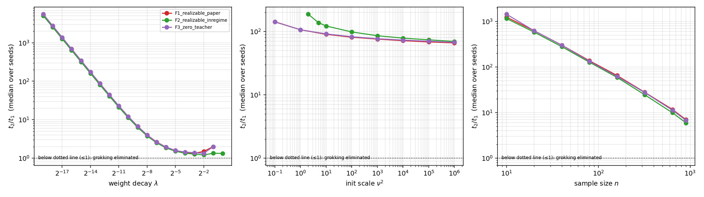

### Diagnosis (not a fit): why is the paper's dashed t1 line ≈2× below the literal Eq. 8?
The literal Eq. 8 t1 bound is ≈1.5×10³ at the Fig. 2 defaults; the paper's dashed line reads ≈6×10² (values eyeballed from the log₂ axes of the paper's `ridge_*.png` figures, which are not redistributed here, ±0.3 octave). I evaluated 24 candidate conventions (λ⁺min empirical vs 1; ε vs 2ε; ‖θ(0)‖² realised / expected mν² / ν²; b²=1.5 or 1) against the 11 read-off points (n and m panels, plus the λ panel). Literal Eq. 8 stays the reported bound everywhere else.

<!--DIAG-->
| rank | λ⁺min | ε factor | ‖θ(0)‖² used | b² | RMS log2 error vs paper's read-off line | mean offset (octaves) | shape-only RMS (octaves) |
|---|---|---|---|---|---|---|---|
| 1 | emp | 1 | nu2 (init var nu2/m) | 1.0 | 0.09 | -0.02 | 0.09 |
| 2 | emp | 1 | nu2 (init var nu2/m) | 1.5 | 0.11 | +0.07 | 0.09 |
| 3 | emp | 2 | nu2 (init var nu2/m) | 1.5 | 0.13 | -0.09 | 0.09 |
| 4 | emp | 2 | nu2 (init var nu2/m) | 1.0 | 0.21 | -0.19 | 0.09 |
| 5 | 1 | 2 | E=m*nu2 | 1.0 | 0.42 | +0.22 | 0.35 |
| 6 | 1 | 2 | emp_||th0||^2 | 1.0 | 0.42 | +0.22 | 0.35 |
| 23 (**literal Eq. 8**) | emp | 1 | E=m·ν² | 1.5 | 1.11 | +1.11 | 0.12 |
| 11 (λ⁺min=1 approx., otherwise literal) | 1 | 1 | E=m·ν² | 1.5 | 0.49 | +0.34 | 0.35 |
<!--/DIAG-->

* The empirical λ⁺min is needed for the *shape* (n and m dependence): replacing it by 1 (the m≫n approximation) gives shape RMS 0.35 octave vs 0.09 and even the wrong direction in m. MP spread alone, ε→2ε alone, or λ⁺min=1 do not close the ≈1.1-octave offset.
* The only candidates that match both offset and shape (RMS ≈0.1 octave) use **‖θ(0)‖² ≈ ν² instead of mν²**, i.e. as if the init had per-coordinate variance ν²/m. This suggests the plotting code of the t1 line differs from Eq. 6/8 as printed (Remark A.14: mν²/2 ≤ ‖θ(0)‖² ≤ 3mν²/2). b²=1 vs 1.5 cannot be separated at this resolution. **Hypothesis, not established**: I only have 11 eyeballed points and chose among 24 candidates, and the same convention would not be consistent with the paper's t2 line, which my literal Eq. 8 matches (≈2^19.3 vs 2^19.2 at λ=2⁻¹⁹).

### Late rise of the unregularised train loss
With λ>0, GD converges to the ridge solution θ\*_λ = (ΦᵀΦ + nλI)⁻¹Φᵀy, not to an interpolant. Early on, GD fits the data (L_n drops to ≈ the interpolation level); then weight decay slowly shrinks θ (‖θ‖² falls from ≈10³ to ≈0.11), moving the iterate from the (near-)interpolating solution toward the ridge solution, which has a **small non-zero train error**. L_n therefore creeps up from its minimum to the ridge solution's train loss. The regularised objective L_n(θ;λ) is monotone (tested); the unregularised L_n is not.
The effect is tiny here: <!--LATE-->
Across the 10 seeds of the realizable default config the largest rise of L_n above its running minimum is 0.0e+00, 0.0e+00, 4.0e-04, 1.4e-02, 0.0e+00, 0.0e+00, 0.0e+00, 0.0e+00, 6.7e-03, 1.2e-02 (relative); 4/10 seeds rise at all. In seed 2: min L_n = 5.6127e-08 at t≈2024, final L_n = 5.6150e-08 = ridge-solution train loss 5.6150e-08; ‖θ‖² goes 982 → 0.1136 (ridge 0.1136 vs interpolant 0.1159). Final test loss 8.841e-04 vs null predictor (θ=0) 1.0e-03: ratio 0.884.
<!--/LATE-->

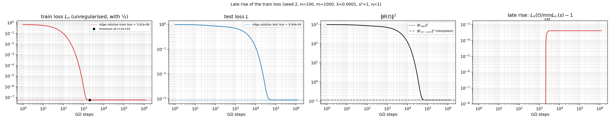


## Part II — Non-linear models (random features and two-layer ReLU networks)

### Fig. 1 left: random ReLU features + zero teacher (`python -m src.nonlinear --fig1l-rf --seeds 50`)
The identity-feature run `fig1_left_zero_teacher` above (N(0,I/m) features) does **not** match the paper's Fig. 1 left: its test loss is flat at 1.0 until ~10⁴ steps, while the paper's falls gradually (0.40 → 0.32 → 0.24 → 0.20 → 0.17 → 0.03 at 10⁰…10⁵ steps). With isotropic features and λ=10⁻⁵ the weights barely shrink before ~10⁴ steps, so that shape is impossible there. The paper's curve is matched by the random ReLU features model (Sec. 5.2, only output layer trained, a~N(0,1), w~N(0,ν²/(dm)I)) with a **zero teacher**, n=100, m=10⁴, λ=1e-5, ν²=1, η=1, x~N(0,I_d) with **d=100** (d is not stated for Fig. 1; I took the Fig. 3 value after a quick check of d ∈ {10,50,100,300}, where d=100 fit best). 50 runs, exact spectral GD.

| steps | my test | paper test (read off figure by eye) | my train (with ½) | paper train |
|---|---|---|---|---|
| 1 | 0.45 | 0.40 | 0.22 | 0.39 |
| 10 | 0.33 | 0.32 | 0.15 | 0.27 |
| 100 | 0.26 | 0.24 | 0.065 | 0.07 |
| 10³ | 0.20 | 0.20 | 0.002 | ≈0.01 |
| 10⁴ | 0.166 | 0.17 | ≈0 | – |
| 10⁵ | 0.027 | 0.03 | ≈0 | – |

Test loss matches within ≈0.02 from step 10 on. The train curve matches only at step 10² and is lower than the paper's before that (the paper's train≈test at step 1; with or without the ½ I do not match that exactly) — an unresolved discrepancy, probably a loss-convention or init-averaging detail. Measured t1 = 443 ± 50, t2 = (1.60 ± 0.07)×10⁵ (ε=c=0.01, 50 runs; Eq. 8's Gaussian-feature bounds are not claimed to apply to this feature map). 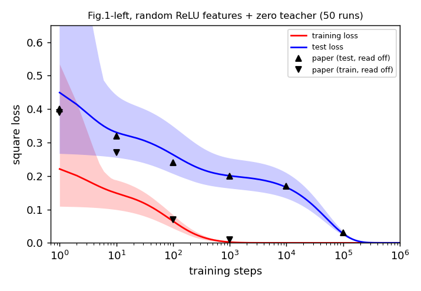

### Fig. 1 right: two-layer ReLU net, zero teacher
(both layers trained, zero teacher, d=50, n=50, m=1000, λ=0.1, ν²=1, η=1e-4, explicit GD in PyTorch float64, **50 independent runs** (own dataset + init each) as in the paper, 6×10⁵ steps; shaded = min–max over runs):
train loss falls below 0.01 at t1 = 2054 ± 269 steps (mean ± sd) while test loss stays high (mean 0.32 at step ~100) until t2 = (7.68 ± 0.48)×10⁴ (c=0.01; range 7.0–9.2×10⁴; found in all 50 runs), i.e. a grokking time ≈ 7.5×10⁴, roughly 37× t1. Final train ≤ 2×10⁻¹⁹, final test ≤ 1.1×10⁻¹¹ in every run. t1/t2 are at log-grid resolution. The run count is the paper's; the step budget is not stated by the paper (mine). Earlier 3-seed run kept as `results/nl_fig1_right_3seeds.json`.
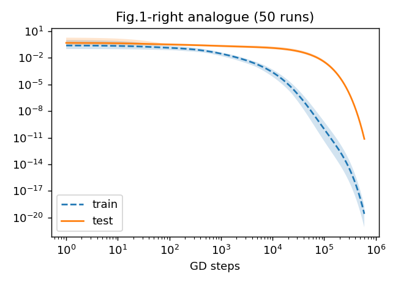

### Fig. 3: random ReLU features, paper's panel values
Compared with the paper's Fig. 3 panels (read off by eye), the single-ReLU-neuron teacher written in the text gives a test floor of ≈0.2 and no t2, whereas the paper's curves go to ≈0 with t2 ∝ 1/λ and start at ≈0.35–0.4 (test at step 1 scales with ν², 0.35 / 2.1 / 3.7 for ν²=1/5/10). A **zero teacher** matches them: random ReLU features, d=100, n=100, m=10⁴, λ=1e-5, ν²=1, η=1, 5 seeds, panel values as in the paper's legends (λ ∈ {1e-4,1e-5,1e-6}, n ∈ {100,200,500}, m ∈ {10³,10⁴,10⁵}, ν² ∈ {1,5,10}).
* **λ:** t2 = 1.52e+04 / 1.61e+05 / 1.56e+06 (paper ≈ 1.5×10⁴ / 10⁵ / 10⁶; ∝ 1/λ); t1 = 437 / 476 / 476 (no λ-dependence).
* **n:** test loss at 10⁴ steps = 0.155 / 0.115 / 0.080 (paper ≈ 0.15 / 0.11 / 0.08); t1 = 476 / 995 / 3064 (grows with n, so small n amplifies grokking).
* **m:** curves nearly identical for m=10³…10⁵ (t2 ≈ 1.5–1.6×10⁵), as in the paper.
* **ν²:** t2 = 1.61e+05 / 2.48e+05 / 2.82e+05, t1 = 476 / 205 / 133; test at 10² steps = 0.26 / 1.00 / 1.91 (paper ≈ 0.22 / 1.2 / 2.5, i.e. mine ≈ 15–25% lower for ν²>1).
Why the text says "single ReLU teacher" yet the curves behave like a zero teacher is unresolved (if inputs/teacher were scaled so that E[y²] ≪ c=0.01 the effect would be the same). Full numbers: `results/nl_fig3_zero_teacher_summary.json` (`python -m src.nonlinear --fig3p --seeds 5`).
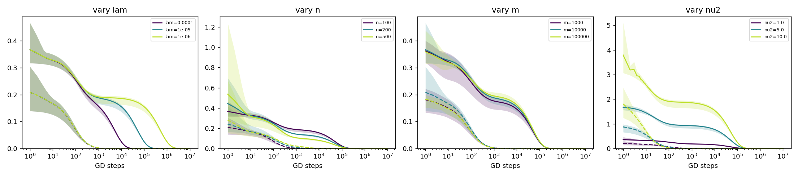


**Negative result — the ReLU teacher written in the paper's text.** (random features, single ReLU teacher σ(⟨w*,x⟩), ‖w\*‖=1, d=100, n=100, m=10⁴, λ=1e-5, ν²=1, η=1; **10 seeds**, exact spectral GD to 10⁷ steps; shaded = min–max over seeds; sweep values are mine since the paper gives none):
train loss reaches ≈1e-6 by ~10⁴ steps while test loss stays near 1 and only drops to a non-zero floor (0.20 ± 0.02 at n=100, vs 0.50 for the zero predictor) around 10⁵–10⁶ steps. Because the teacher is non-realizable the floor is far above c=0.01, so t2 at c=0.01 is never reached; the delay is visible in the curves, not as a t2 number. t1 (mean ± sd over seeds): n=50/100/200 → 301±57 / 669±111 / 1641±144; ν²=0.25/1/4 → 2131±358 / 669±111 / 251±31; λ has no effect on t1 (669 for 1e-4, 1e-5, 1e-6); m=2000/5000/10⁴ → 708±88 / 743±103 / 669±111 (no clear trend). Final test floor falls with n (0.27 / 0.20 / 0.15) and is independent of λ, m, ν². Full numbers: `results/nl_fig3_summary.json` (the earlier 2-seed run is kept as `nl_fig3_summary_2seeds.json`).
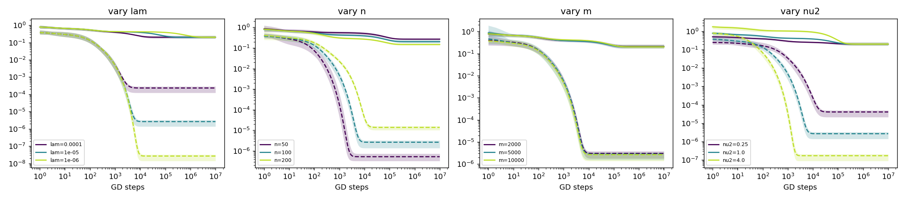


### Fig. 4: fully-trained two-layer net, zero teacher (`python -m src.nonlinear --fig4 --seeds 6`)
Base n=50, m=1000, d=50, ν²=1, λ=0.05, η=1e-4, 10⁶ steps, **6 seeds**, shaded = min–max over seeds; one parameter varied at a time (grids are mine). t1/t2 at ε=c=0.01, log-grid resolution, mean ± sd over seeds (`results/nl_fig4_summary.json`; earlier 2-seed run kept as `nl_fig4_summary_2seeds.json`).

| varied | value | t1 | t2 |
|---|---|---|---|
| λ | 0.025 / 0.05 / 0.1 | 2215±265 / 2215±265 / 2176±210 | (3.00±0.16)×10⁵ / (1.47±0.07)×10⁵ / (7.5±0.4)×10⁴ |
| n | 25 / 50 / 100 | 946±109 / 2215±265 / 4426±393 | (1.77±0.08)×10⁵ / (1.47±0.07)×10⁵ / (1.34±0.09)×10⁵ |
| m | 500 / 1000 / 2000 | 3625±372 / 2215±265 / 1070±119 | (1.54±0.05)×10⁵ / (1.47±0.07)×10⁵ / (1.50±0.07)×10⁵ |
| ν² | 0.5 / 1 / 2 | 2545±296 / 2215±265 / 1756±193 | (1.10±0.07)×10⁵ / (1.47±0.07)×10⁵ / (1.86±0.06)×10⁵ |

Qualitatively as in the ridge theory: t2 ∝ 1/λ (halving λ doubles t2), t1 independent of λ, smaller n lowers t1 (amplifies grokking; t2 also changes mildly), larger ν² raises t2 and lowers t1 (amplifies), m has little effect on t2. Unlike the paper's claim for the ridge bounds (little effect of m), t1 here clearly decreases with m (≈3.4× from m=500 to 2000, well outside the seed spread); the paper's own Fig. 4 width panel shows the same decrease (≈780 → 450 for m = 2000 → 4000), so this is consistent with the paper. t1/t2 values at the base point coincide across panels because they are the same runs. 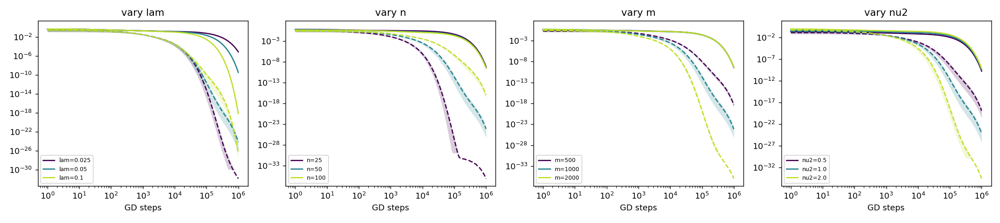

### Appendix B: Figs. 5–7 (`python -m src.appendix`)
Exact spectral GD, MC test loss. Paper values are read off its figures by eye. Numbers: `results/app_summary.json` (earlier, non-matching versions: `results/app_summary_old_models.json`).
* **Fig. 5 (surrogate accuracy P[N²≤0.01], single run as in the paper): random ReLU features + zero teacher, m=10⁴, d=100, n=100, λ=1e-5.** Test accuracy at 10¹/10²/10³/10⁴/10⁵ steps = 0.125 / 0.138 / 0.164 / 0.188 / 0.462, final 1.00; paper ≈ 0.15 / 0.15 / 0.18 / 0.19 / 0.45, → 1.0 at ≈2×10⁵. (Step 1: mine 0.05 vs paper ≈ 0.12, single-run noise.) My earlier version used the ReLU teacher and only reached 0.21. 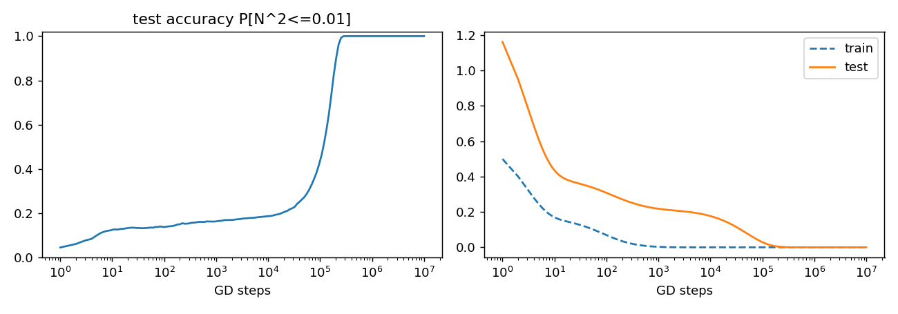
* **Fig. 6 (label noise): random ReLU features, d=50, m=5000, n=100, λ=1e-5, zero teacher, 10 seeds.** Test loss for std=0.01 at 10⁰…10⁵ steps = 0.409 / 0.307 / 0.197 / 0.133 / 0.109 / 0.016; paper ≈ 0.385 / 0.28 / 0.18 / 0.145 / 0.12 / 0.02. t2 = 1.38e+05 / 1.44e+05 / 1.7e+05 for std = 0.01 / 0.05 / 0.1: noise barely changes grokking time, as in the paper (≈ +25% at std=0.1); it raises the final test loss (5×10⁻⁵ → 5×10⁻³). Train loss at 10² steps: 0.056 (paper ≈ 0.045). The earlier identity-feature version (flat test curve) did not match. 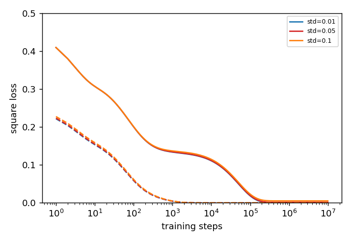
* **Fig. 7 (random Fourier features): m=5000, d=10, n=100, λ=1e-4, x~N(0,I₁₀), teacher θ\*=e₁ (literal "one random Fourier feature", target amplitude √(2/m)), 10 seeds.** Test loss at 10⁰…10⁵ steps = 1.00 / 0.99 / 0.94 / 0.77 / 0.11 / 0.0002, paper ≈ 0.95 / 0.93 / 0.885 / 0.877 / 0.735 / 0.12. Same shape (plateau ≈ 0.9, late drop to ≈0) but **my drop happens ≈1 decade earlier** (t2 = 2.34e+04; paper ≈ 2×10⁵); t1 = 192. Cause not found (λ and θ(0) scale are as stated). Because the teacher has tiny variance (zero-predictor loss ≈ 2×10⁻⁴ ≪ c), "generalisation" here is mostly weight decay removing init noise. My earlier amplitude-√m / input-scale scan was unnecessary and is superseded. 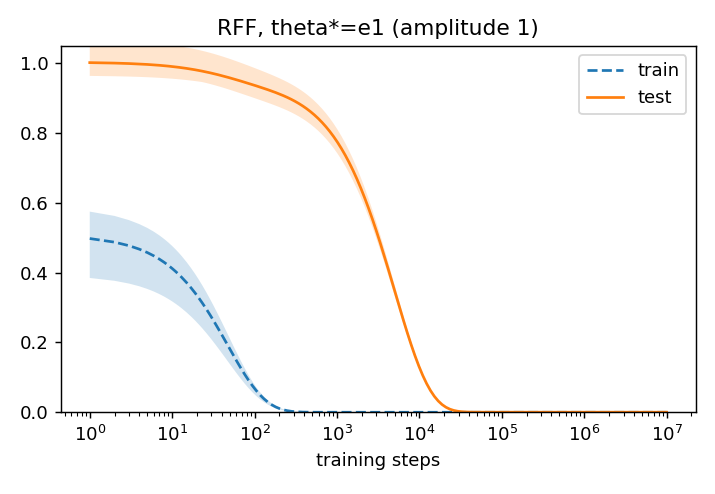

## Deviations from the paper / caveats
1. **Paper values are read off figures by eye** (≈ ±10–15 %); no underlying data was available.
2. **Settings chosen by me** (not in the paper): input distribution x ~ N(0, I_d); d=100 for Fig. 1 left; all sweep grids for Figs. 2–4; step budgets; the teacher direction θ\* ~ N(0,I) normalised; test sets (exact closed form + 10k MC for ridge, 3–5k MC otherwise).
3. **Seeds:** Fig. 1 left and right use 50 runs (as the paper). Not stated by the paper, my choice: Fig. 2-type sweeps 10, Fig. 3 5, Fig. 4 6, Fig. 6/7 10, Fig. 5 one run (as the paper).
4. **Engine:** exact spectral iterates instead of iterating GD for 10⁶–10⁷ steps (verified equal to explicit GD to ≈1e-15; float64). The two-layer net (Figs. 1 right, 4) uses explicit GD.
5. **Larger sweep ranges than the paper** for the ridge sweeps (λ up to 2⁰, n up to 900, ν² down to 10⁻², extra η and m values) and two additional families (F2, F3). Points outside Eq. 8's validity (ηλ>0.01) only have measured values.
6. **Theory conditions are not met at the paper's scale** (Eq. 3 would need n ≈ 7×10⁴ at C=1) and the paper's η=1 violates Thm 4.2's own η < 1/(λ+b²) (b² ≥ ‖φ‖² ≈ 1). The bounds nevertheless held in all 2670 checks.
7. **Unresolved differences:** Fig. 7 timing (≈10× early); the dashed t1 line in Fig. 2 (≈2.5× below the literal Eq. 8); Fig. 1-left/right train loss before step ≈10² (lower than the paper's, possibly a loss-convention or averaging detail); why the Fig. 3 text says "single ReLU teacher" while the curves match a zero teacher; ν²=5,10 test curves in Fig. 3 are ≈15–25 % below the paper's.
